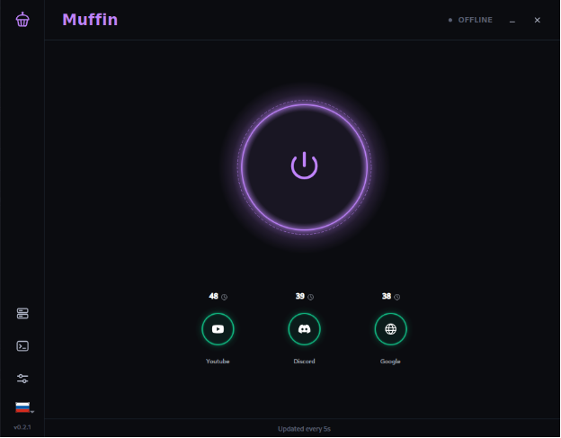
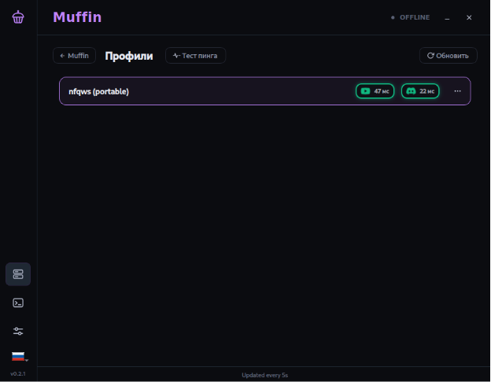
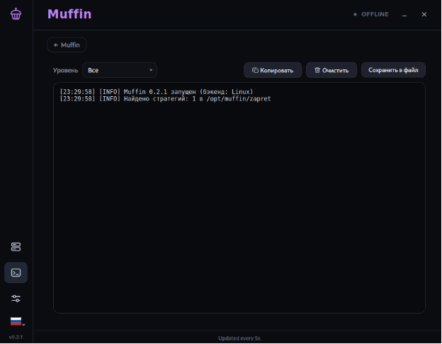
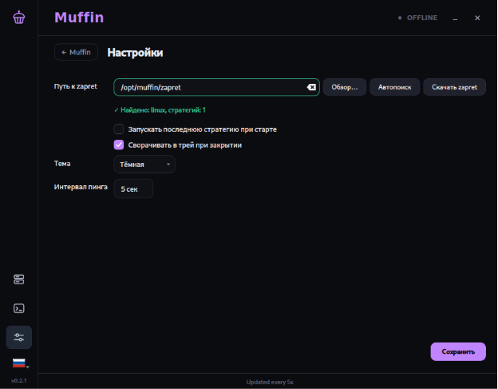

# 🧁 Muffin

**Muffin** — это кроссплатформенный графический интерфейс (GUI) для управления популярной утилитой обхода блокировок **zapret**. 

Приложение создано для того, чтобы вам больше не приходилось вручную редактировать `.bat` файлы, запускать скрипты в терминале и вводить команды. Всё управление происходит в удобном, современном и красивом интерфейсе.

[](https://github.com/F0RSES/zapret-muffin-gui/actions/workflows/ci.yml)

---

## ✨ Главные возможности

* **Кроссплатформенность:** Поддержка Windows (через `winws.exe`) и Linux (через `nfqws` и `iptables`).
* **Автоматическая установка:** Кнопка «Скачать zapret» сама загрузит актуальную версию с GitHub, проверит контрольную сумму и распакует её.
* **Автообновление Muffin:** Через несколько секунд после запуска приложение проверяет релизы собственного репозитория на GitHub. Если вышла новая версия, в шапке окна появляется пульсирующая иконка; по нажатию она спрашивает и открывает страницу релизов в браузере. Сама замена приложения требует прав root и будет сделана позже.
* **Умный запуск:** Большая кнопка в один клик запускает или останавливает обход. Больше не нужно вводить пароли каждый раз (используются правила Polkit).
* **Watchdog:** Приложение само, раз в несколько минут (интервал настраивается), проверяет, что запущенный профиль всё ещё обходит блокировки. Если провайдер сменил правила, Muffin сообщит об этом и предложит переключиться на следующий профиль.
* **Мультиязычность:** Поддержка 7 языков (Русский, Английский, Немецкий, Испанский, Китайский, Французский, Хинди).
* **Современный дизайн:** Темная и светлая темы, кастомное окно, системный трей и живые индикаторы пинга.

---

## 📸 Скриншоты

| Главный экран | Профили |
| :---: | :---: |
|  |  |

| Логи | Настройки |
| :---: | :---: |
|  |  |

---

## 📥 Установка

Скачать готовые установочные файлы можно на странице **[Releases](https://github.com/F0RSES/zapret-muffin-gui/releases)**.

### Windows

1. Скачайте `Muffin-Setup-x.x.x.exe`.
2. Запустите установщик (потребуются права администратора, так как для работы драйвера WinDivert нужен доступ к сети).
3. Запустите Muffin из меню «Пуск».

### Debian / Ubuntu / Kali Linux

1. Скачайте `muffin_x.x.x_amd64.deb`.
2. Установите через терминал:

   ```bash
   sudo apt install ./muffin_x.x.x_amd64.deb
   ```

### Arch Linux

В репозитории есть готовый `PKGBUILD` (в папке `packaging/arch`).

```bash
cd packaging/arch
makepkg -si
```

---

## 📚 Источники zapret

Приложение скачивает оригинальные бинарники из официальных репозиториев:

* **Для Windows:** `Flowseal/zapret-discord-youtube`
* **Для Linux:** `bol-van/zapret`

**Примечание для Linux:** Muffin использует портативный режим `nfqws`. Он не требует установки в систему, а сам управляет правилами `iptables` через `pkexec`. Оригинальные исходники `nfqws` берутся из релизов `bol-van`.

---

## 🛠️ Сборка из исходников (для разработчиков)

### Требования

* Qt 6.6+
* CMake 3.21+
* Компилятор (GCC 11+ для Linux / MSVC 2022 для Windows)

### Сборка

```bash
./scripts/build.sh
ctest --output-on-failure
```

---

## 📄 Лицензия

Этот проект распространяется под лицензией MIT. Подробности в файле `LICENSE`.